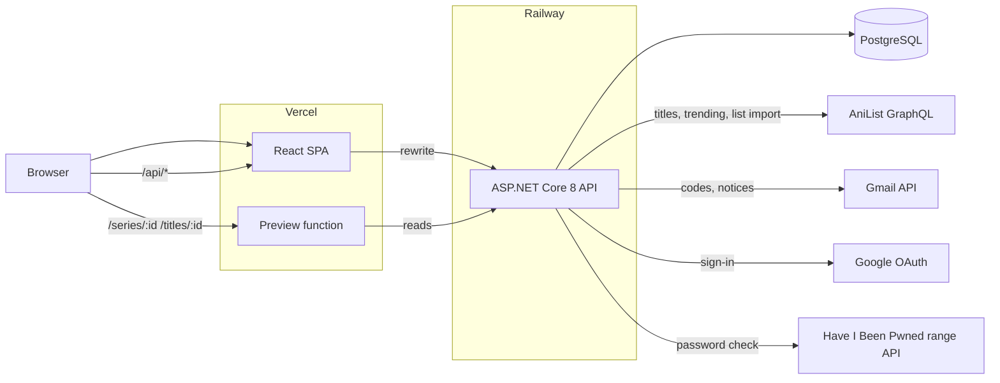
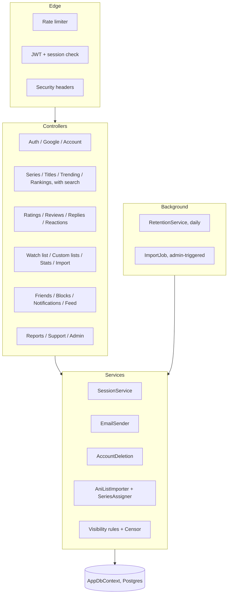

# GengaRate

This is a personal/portfolio project I built for fun. I figured building and deploying a live site would be a good challenge and a way to show off my design skills. All the titles on the site come from AniList.

The live site is at [www.gengarate.com](https://www.gengarate.com).

## Parts



The browser only ever talks to the Vercel origin. `/api/*` is rewritten to Railway, so the refresh cookie is first-party.

## Repo

```text
api/            ASP.NET Core 8, EF Core, Identity, 15 migrations
api.Tests/      xUnit, InMemory by default, Postgres when TEST_PG is set
web/            React 19, react-router 7, Vite, TypeScript
  api/          Vercel function for link previews
  scripts/      contrast check, prerender, og-image
.github/        CI: api job, web job
```

## API layers



## A bunch of boring documentation

| | |
|---|---|
| [docs/data.md](docs/data.md) | Tables, ratings math, visibility, deletion, retention |
| [docs/auth.md](docs/auth.md) | Sign-in, Google, sessions, reset, delete |
| [docs/flows.md](docs/flows.md) | What a user can do, screen by screen |
| [docs/frontend.md](docs/frontend.md) | Routes, components, state, theme, tokens |
| [docs/ops.md](docs/ops.md) | Deploy, CI, config, limits, security |
| [STYLE.md](STYLE.md) | Design rules |
| [DEPLOY.md](DEPLOY.md) | First-time setup of Railway, Vercel, Gmail, Google |
| [SECURITY.md](SECURITY.md) | Reporting a vulnerability |

The route list lives in the API itself: `/docs` (Swagger UI), `/docs/v1/openapi.json`.

## How to run it locally in case you're into that ig

Needs the .NET 8 SDK, Node 20+ and PostgreSQL.

```bash
cd api && dotnet run
cd web && npm install && npm run dev
```

Load titles once from the Admin page (Import titles), or `dotnet api.dll import`.

```bash
cd api.Tests && dotnet test                # InMemory
TEST_PG="Host=localhost;Username=...;Password=..." dotnet test   # adds the Postgres suites
cd web && npm run check:contrast && npm run build
```

Settings are in [docs/ops.md](docs/ops.md#configuration). No values are committed.
