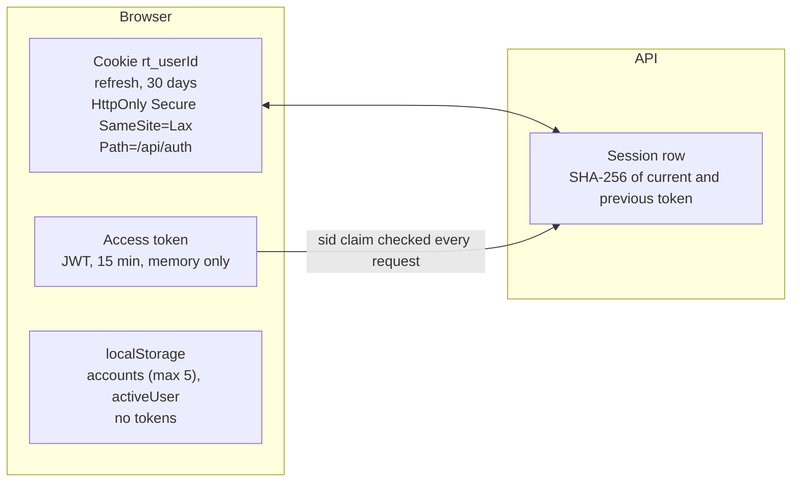
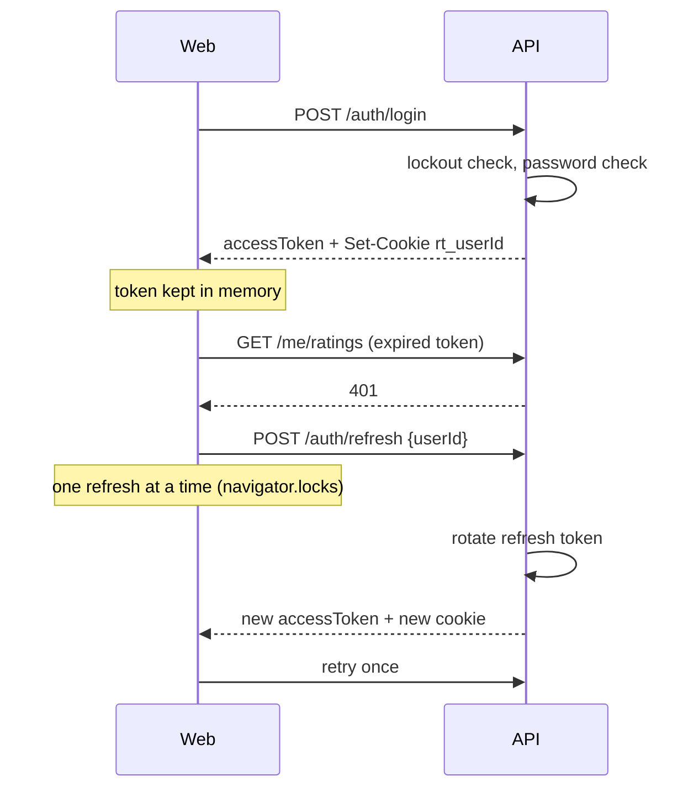
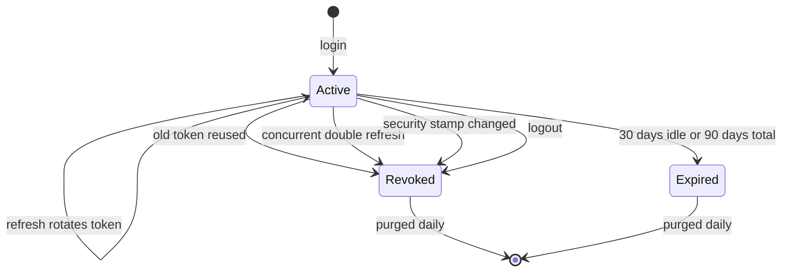
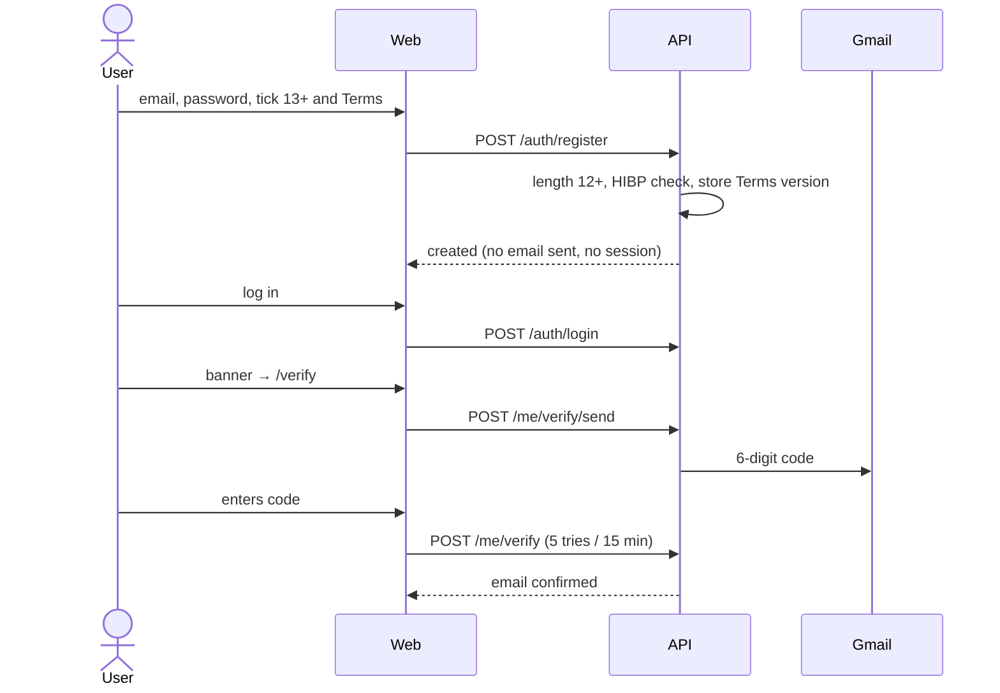
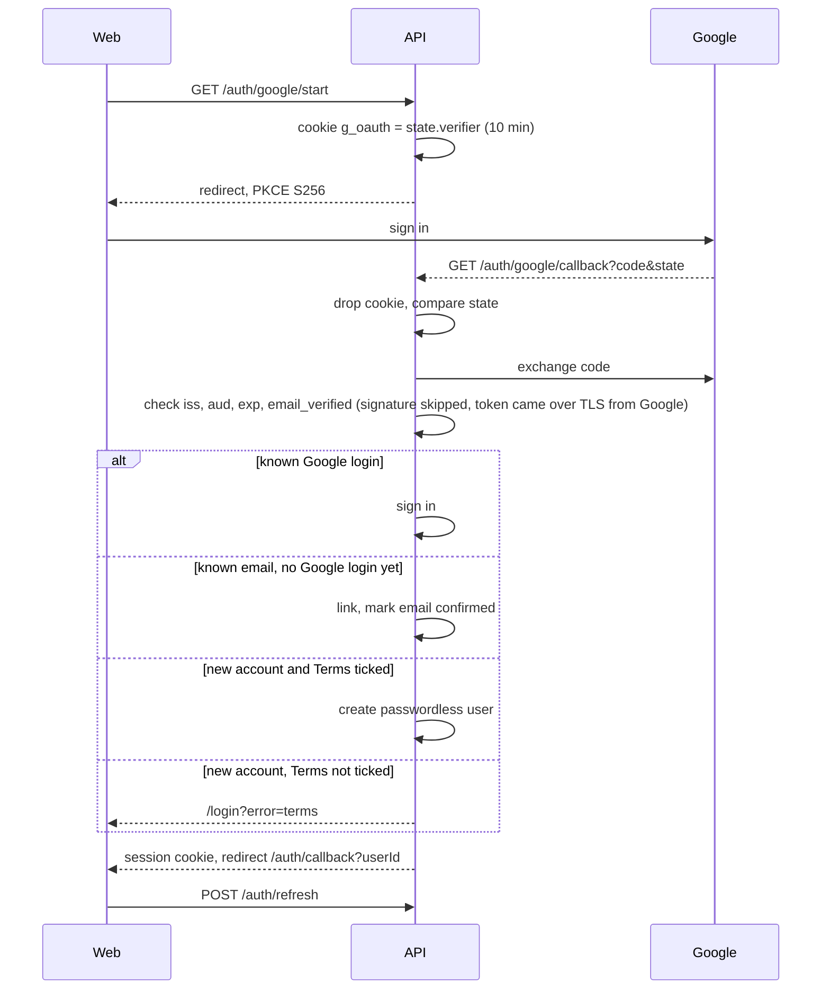
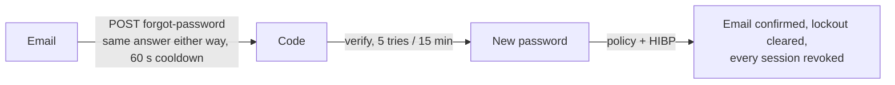
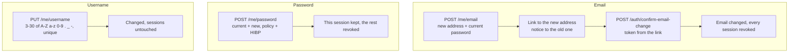
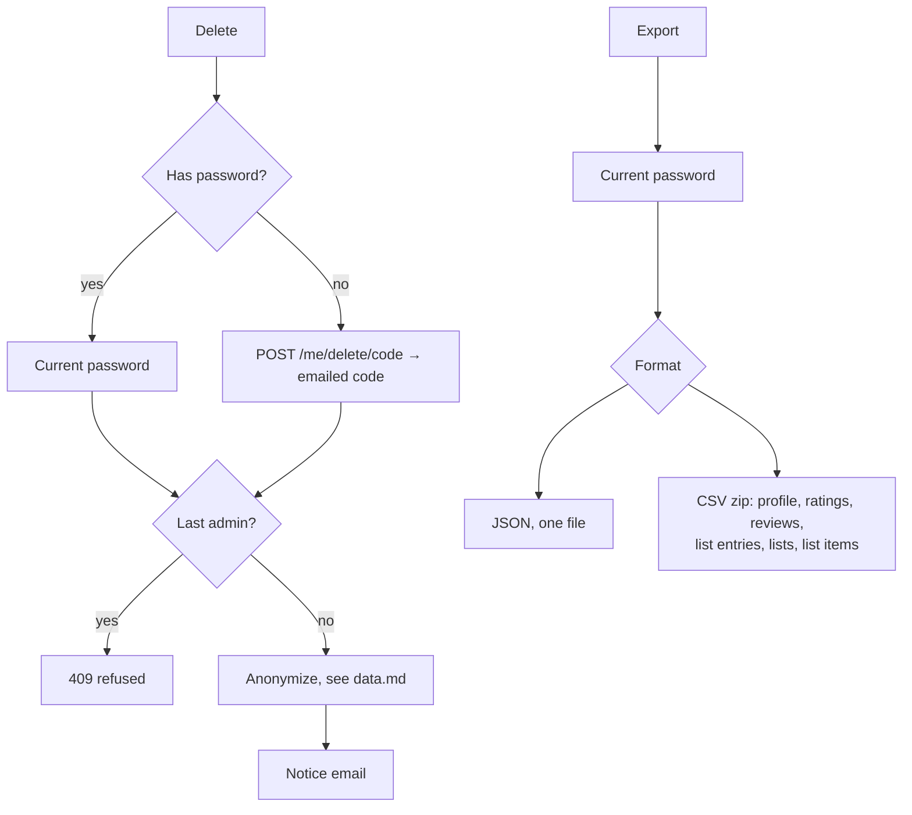

# Auth

Password or Google. No second factor at login. Emailed 6-digit codes are used for three things only: verify email, reset password, confirm account deletion for accounts without a password.

## Tokens

Up to five accounts can be signed in at once, one cookie each. A session lasts 30 days sliding, 90 days at most.

## Sign in and refresh

Ten failed logins lock the account for 5 minutes (423). Sensitive actions answer 403 or 400, never 401, so the client does not retry and double-count a wrong password.

## Session states

Password change, email change and password reset rotate the stamp. A password change keeps the current session and ends the rest.

## Register and verify

Review text, replies and reports need a verified email.

## Google

If an existing account's email was never verified, linking removes its password and sessions so nobody can pre-claim an address.

## Reset password

Google-only accounts use this to add a password.

## Change email, password, username

A wrong current password answers 403 and counts toward the lockout. Google-only accounts have no password, so they cannot use the email or password routes until they add one through Reset password. A blocked address gets the same silent 200, and sends are limited to one a minute per address and per user.

## Delete and export

Export needs a password, so it is hidden for Google-only accounts. CSV cells starting with `= + - @`, tab or carriage return get a leading apostrophe.

## First admin

`Admin__Email` names the first admin. The matching user is promoted at login, Google login or email verify, once their email is confirmed and no admin exists. Admin status is re-read from the database on every request.
