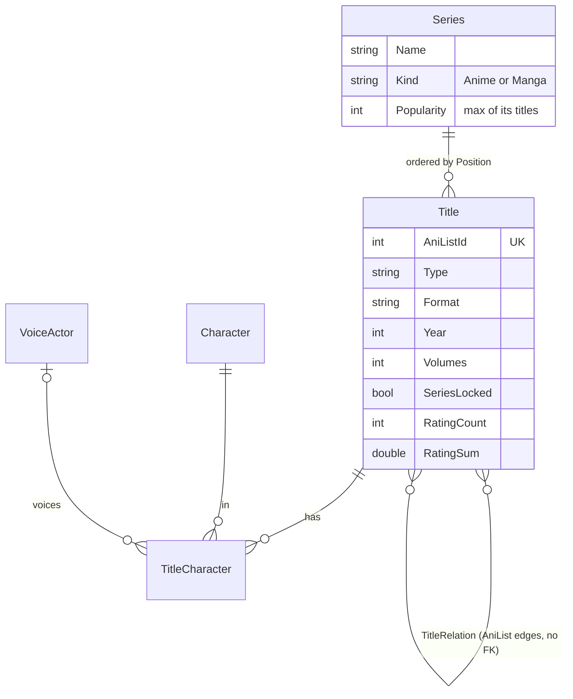
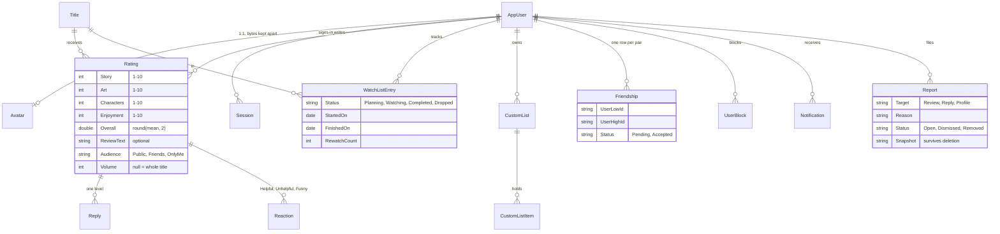
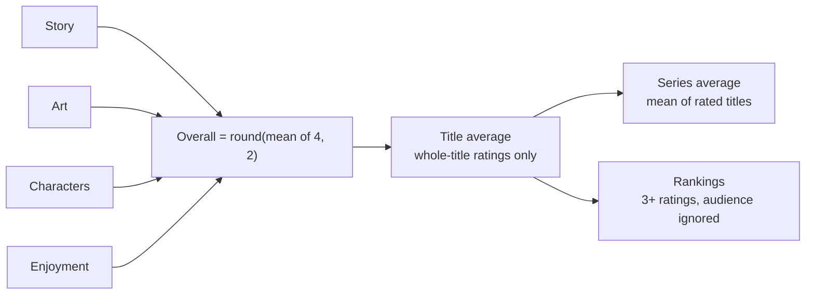
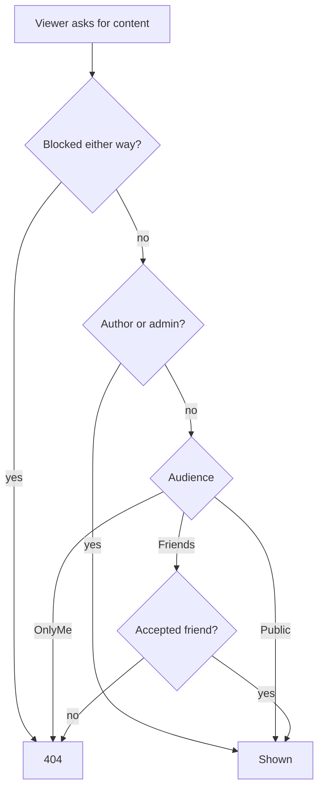
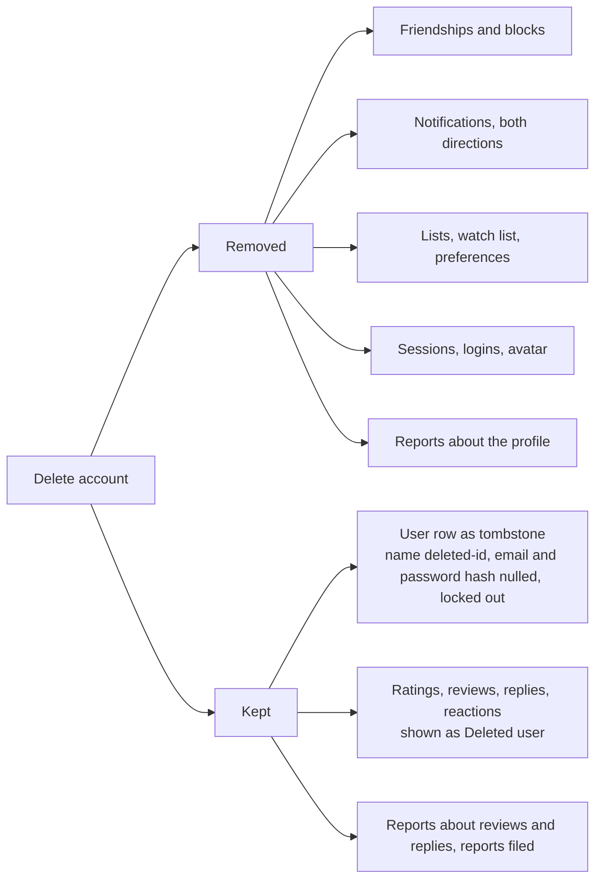
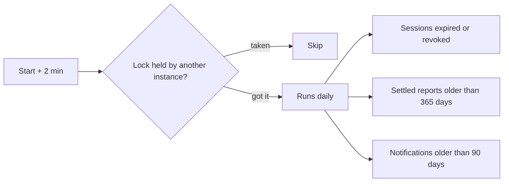
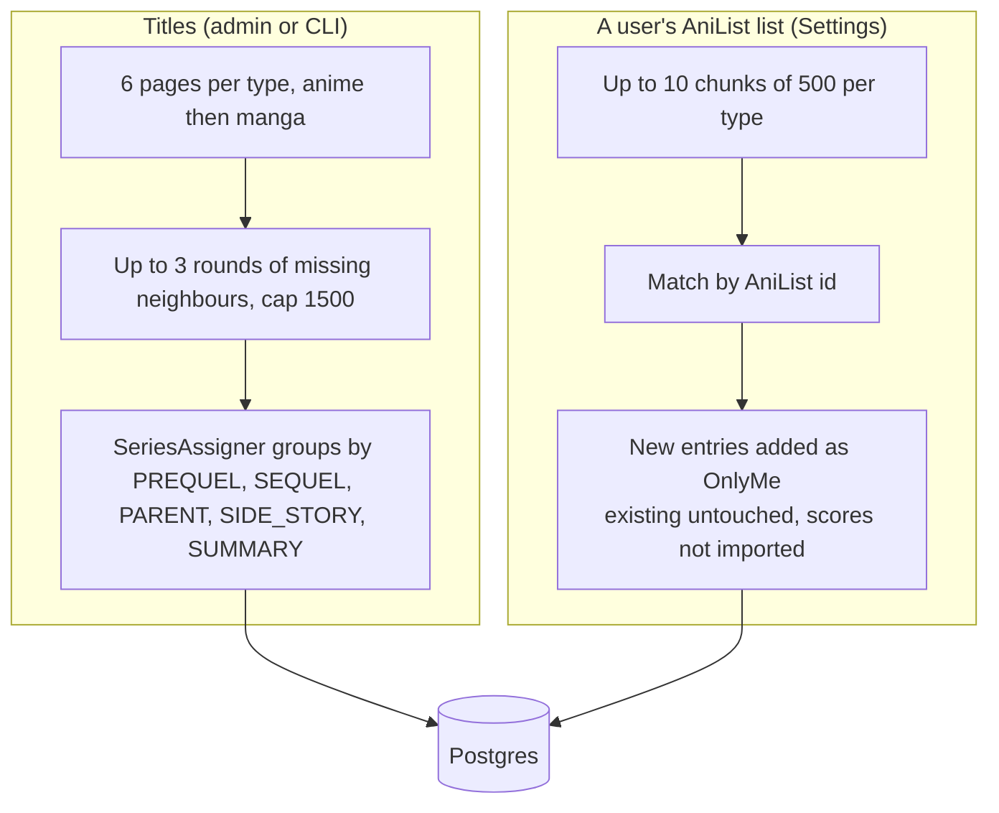

# Data

PostgreSQL through EF Core. Enums are stored as strings. Identity tables hang off `AspNetUsers`.

## Catalog

Anime and manga never share a series. `SeriesLocked` is set by an admin move or merge, and the importer then leaves that title alone. Names are indexed with trigram GIN for search.

## Users and content

A review is a rating with text. `CustomListItem` points at a title or a series, never both (check constraint). `Report` has no FK to its target so it outlives it.

## Rating math

Per-volume ratings are stored but excluded from title averages. Aggregates, rankings and "also rated" ignore audience.

## Who sees a review

Hidden, blocked and missing all answer the same 404. Admins skip the rule for reviews and replies, not for lists or the feed.

## Account deletion

One transaction.

A lone admin cannot delete (409). Tombstones are never purged.

## Retention

Each step is isolated, so one failure does not stop the others. Pending friend requests older than 30 days are pruned when friend lists are read. Emailed codes are not stored.

## Imports

The title import takes a Postgres advisory lock. A user's list import is guarded in memory: one per user, three at a time. AniList is called with a 700 ms pause and honors `Retry-After` on 429. Trending is cached 10 minutes with a stale copy kept for when AniList is down.
