# User flows

## Map

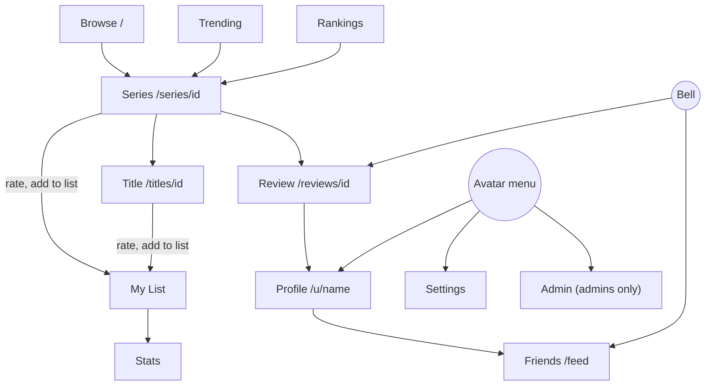

## Browse

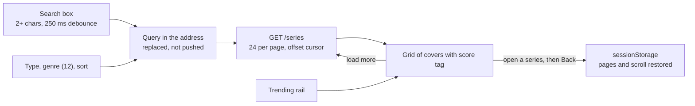

Sorts: Popular (most ratings), Top rated, Newest, A to Z. Every order ends in the id so pages never repeat. A rating bumps a version that discards the stored snapshot.

### Ratings scope

Signed-in people get a Ratings dropdown: All (default), Friends only, Only me. It sits with the filters on Browse and Rankings, and under the score on Series and Title pages. One choice drives them all, including reviews and Also rated, and it is kept in `localStorage` until you switch account or log out. The scope is part of the Browse address and snapshot, so Back never restores another scope's page.

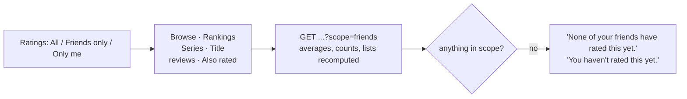

On a profile the dropdown is separate and local: another person's profile offers All and Friends only (what they shared with friends), your own adds Only me. It drives the overview (top titles, top genres, rating count).

## Rate a title

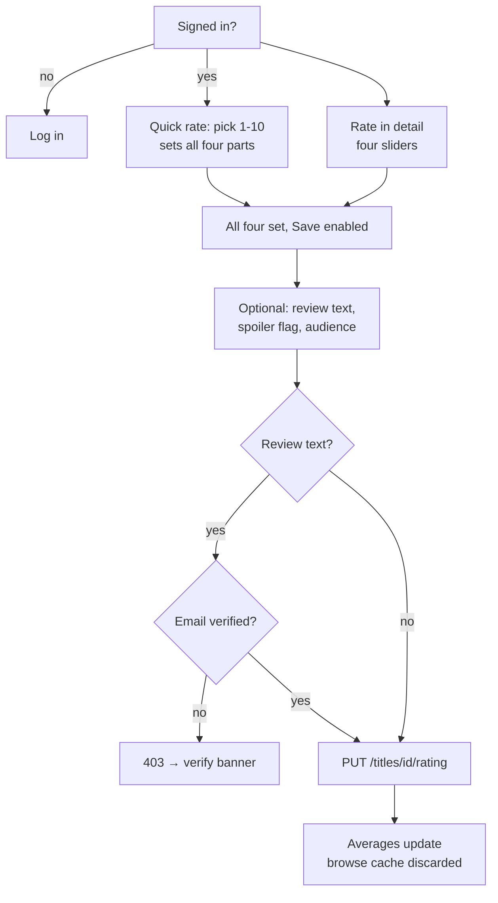

Manga with a known volume count also get a volume picker. Nothing is pre-filled for a title you have not rated.

## My List

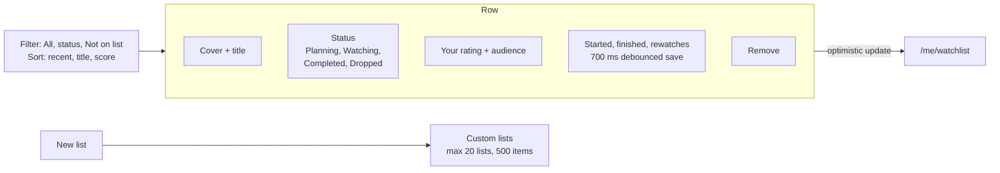

30 rows show before "Show more". Filters live in the address.

## Review, reply, react

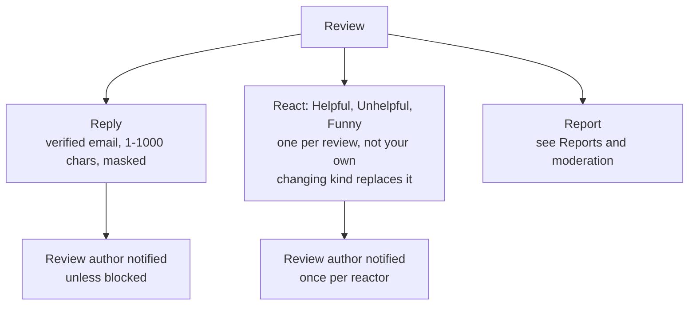

Reviews list 10 at a time, by helpful (default) or newest. Replies are oldest first, one level deep. The reply author or the review author can delete a reply. Helpful minus Unhelpful is the review's score.

## Import your AniList list

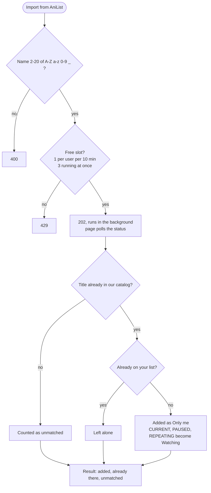

A private or unknown list stops with an error. Dates are kept only if they pass the same checks as the edit row (nothing after tomorrow, finish not before start). The status is in memory, so a restart loses it.

## Friends

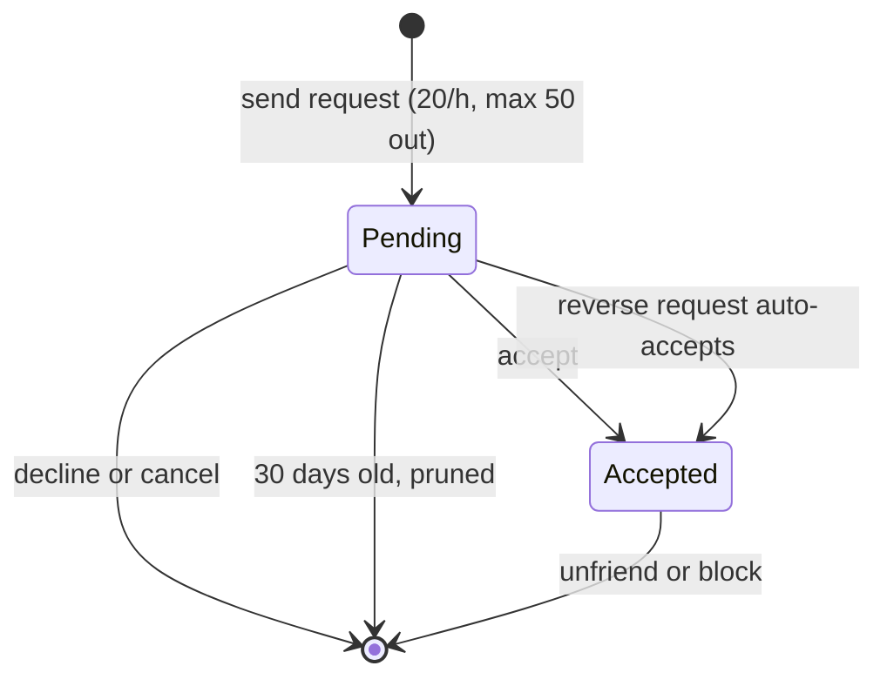

The feed under it lists friends' ratings and reviews, filtered by the visibility rule. Spoiler reviews show no snippet. Blocking is silent: it ends any friendship, clears notifications between the two, and the blocked user's lookups return 404.

## Notifications

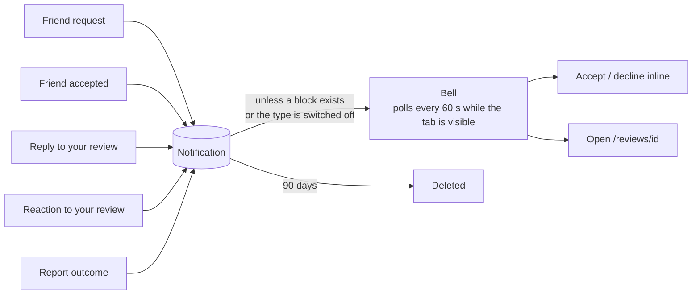

Per-type switches are in the avatar menu under Notification preferences. A reaction notifies once per reactor.

## Reports and moderation

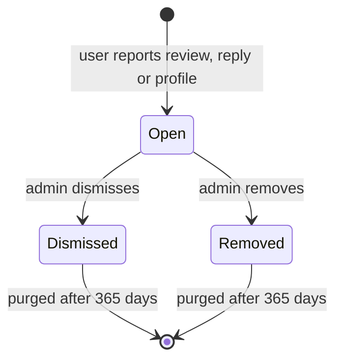

| Target | Remove does |
|---|---|
| Review | strips the text, keeps the score |
| Reply | deletes it |
| Profile | clears bio and/or picture |

Removing settles every open report on the same target. The reporter gets a Report outcome notification. You can only report what you can see, not your own content, and once while a report is open. Reports need a verified email (10 an hour).

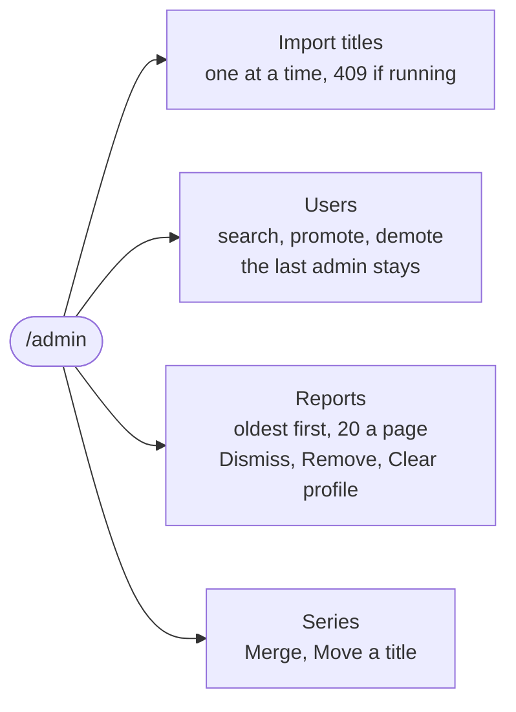

## Settings

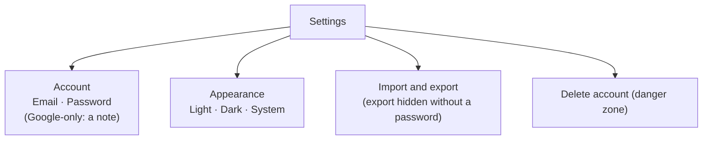

## Profile

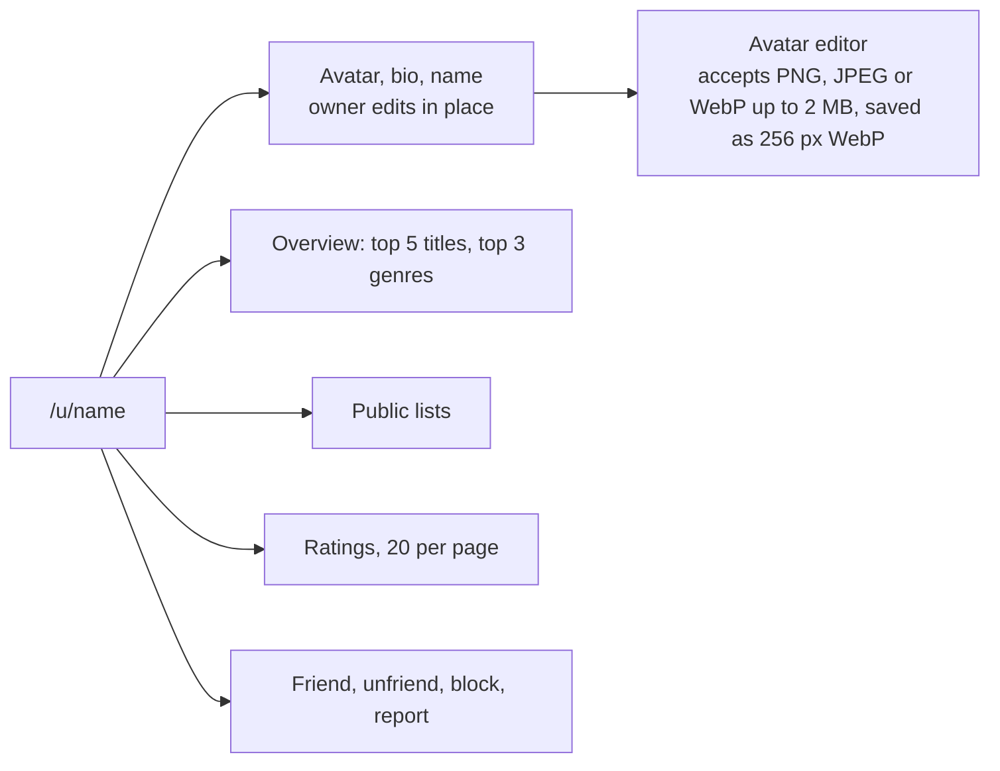

Pictures are public, including to people you have blocked. A deleted account shows as "Deleted user" and its picture is gone.
