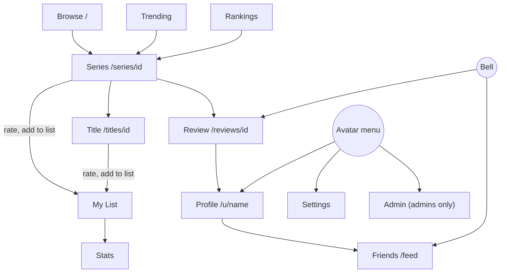
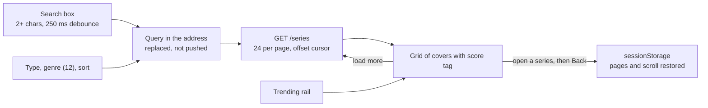
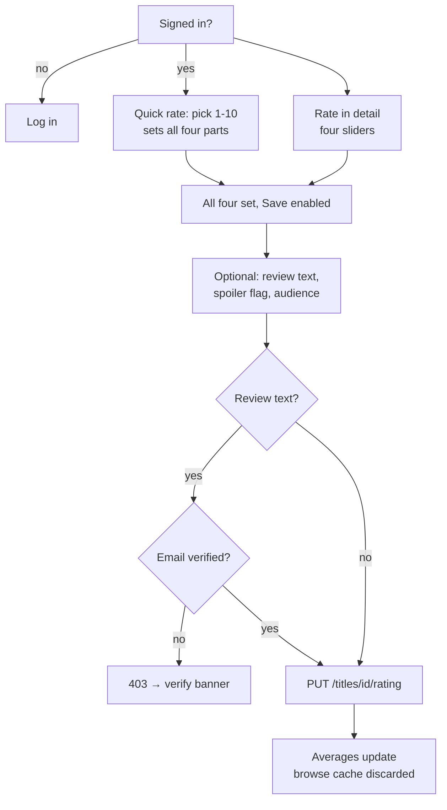
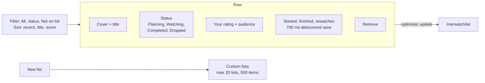
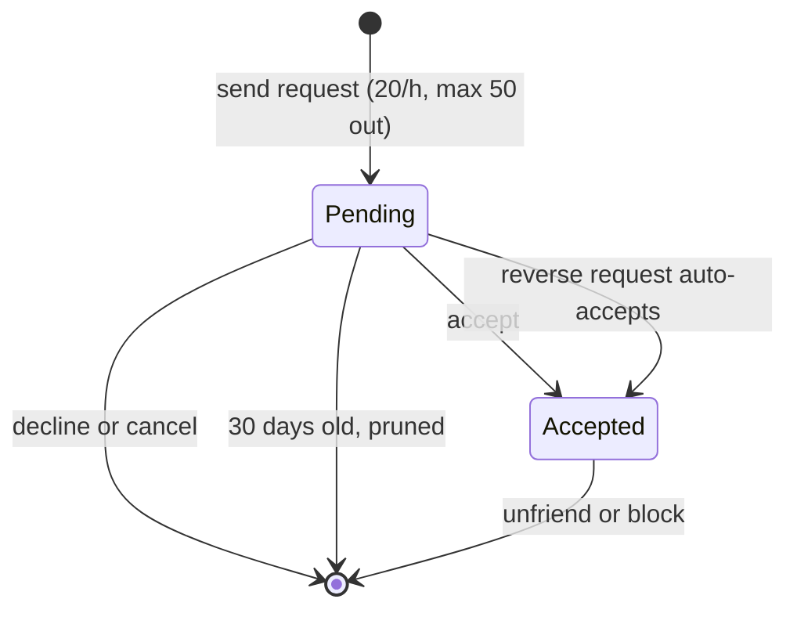
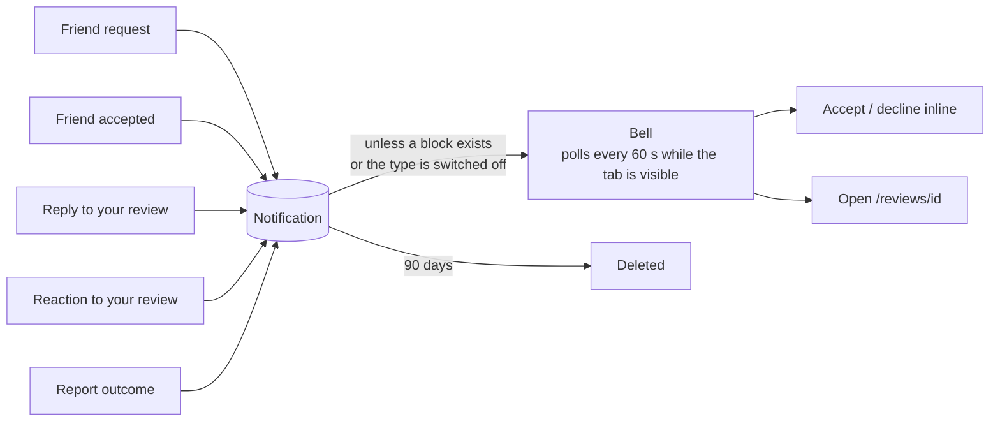
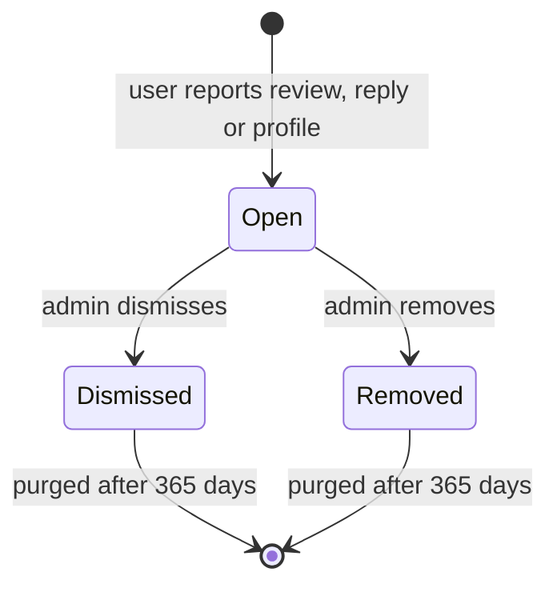
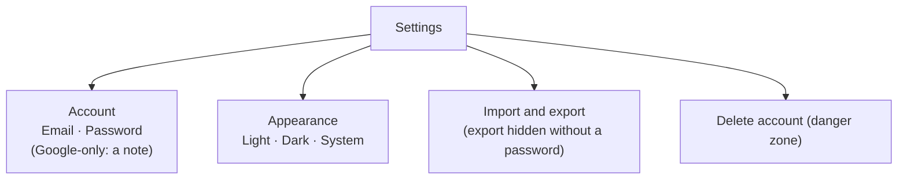
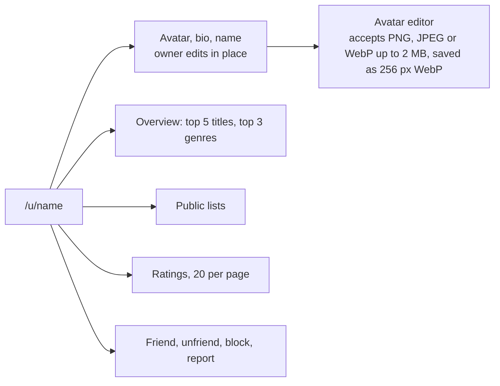

# User flows

## Map

## Browse

Sorts: Popular (most ratings), Top rated, Newest, A to Z. Every order ends in the id so pages never repeat. A rating bumps a version that discards the stored snapshot.

## Rate a title

Manga with a known volume count also get a volume picker. Nothing is pre-filled for a title you have not rated.

## My List

30 rows show before "Show more". Filters live in the address.

## Friends

The feed under it lists friends' ratings and reviews, filtered by the visibility rule. Spoiler reviews show no snippet. Blocking is silent: it ends any friendship, clears notifications between the two, and the blocked user's lookups return 404.

## Notifications

Per-type switches are in the avatar menu under Notification preferences. A reaction notifies once per reactor.

## Reports and moderation

| Target | Remove does |
|---|---|
| Review | strips the text, keeps the score |
| Reply | deletes it |
| Profile | clears bio and/or picture |

Removing settles every open report on the same target. The reporter gets a Report outcome notification. You can only report what you can see, not your own content, and once while a report is open. Reports need a verified email (10 an hour).

Admin page: Import titles, Users (promote, demote; last admin stays), Reports queue (oldest first), Series tools (merge, move a title).

## Settings

## Profile

Pictures are public, including to people you have blocked. A deleted account shows as "Deleted user" and its picture is gone.
