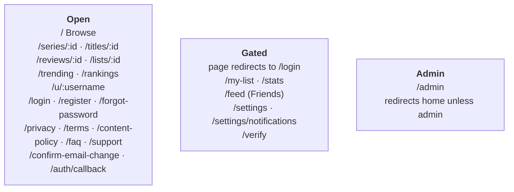
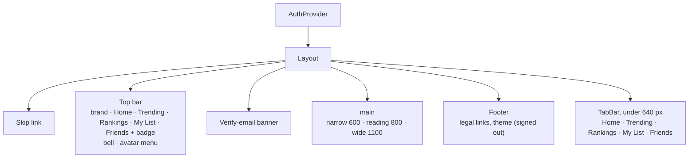
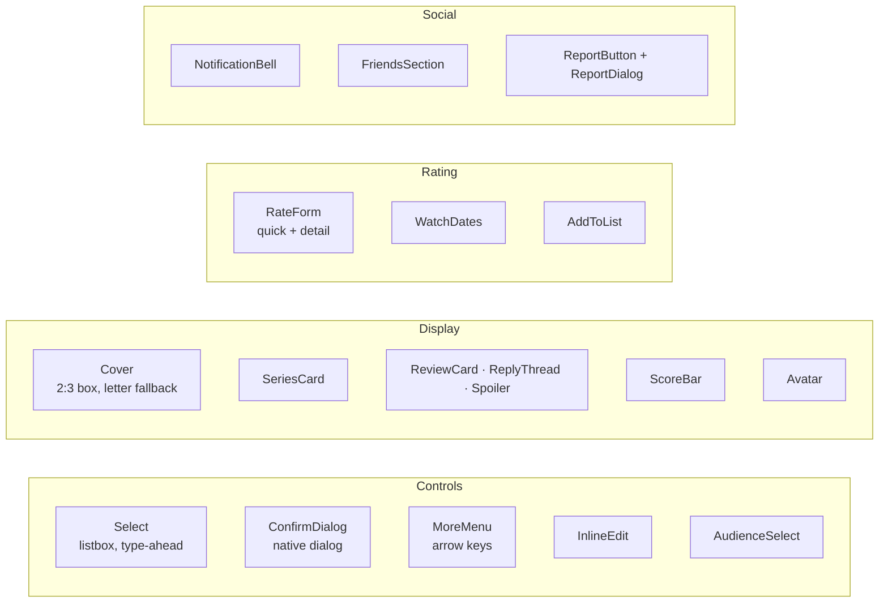
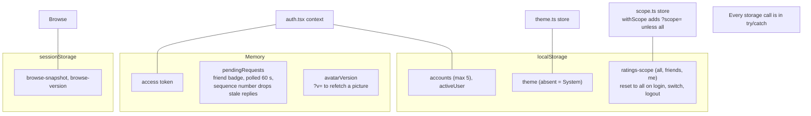
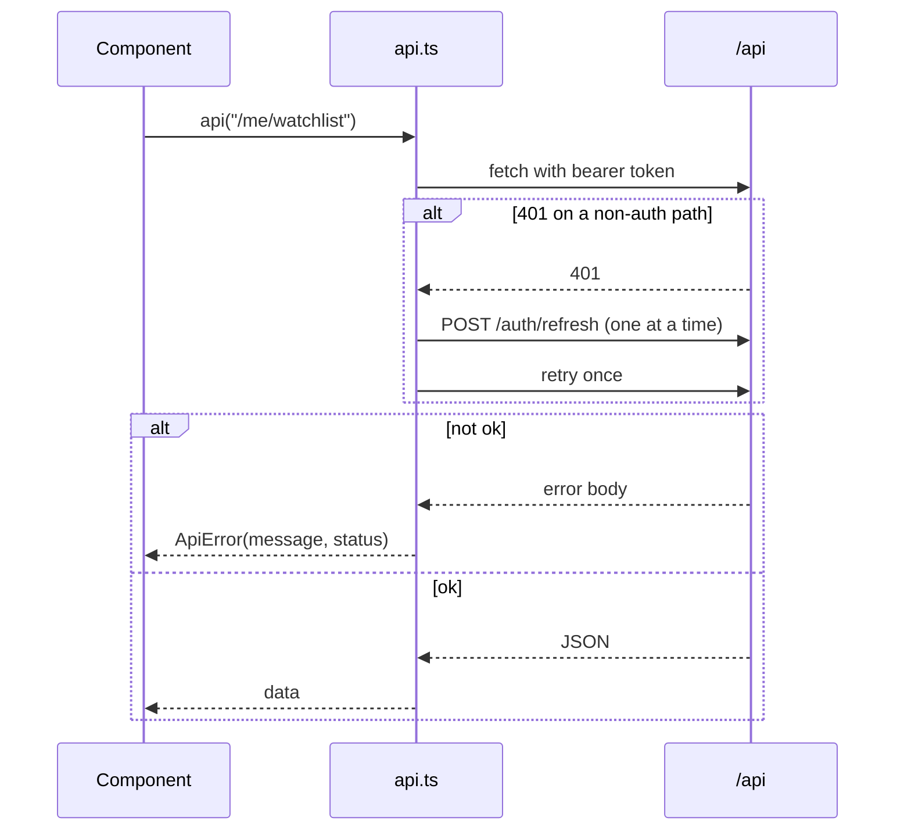
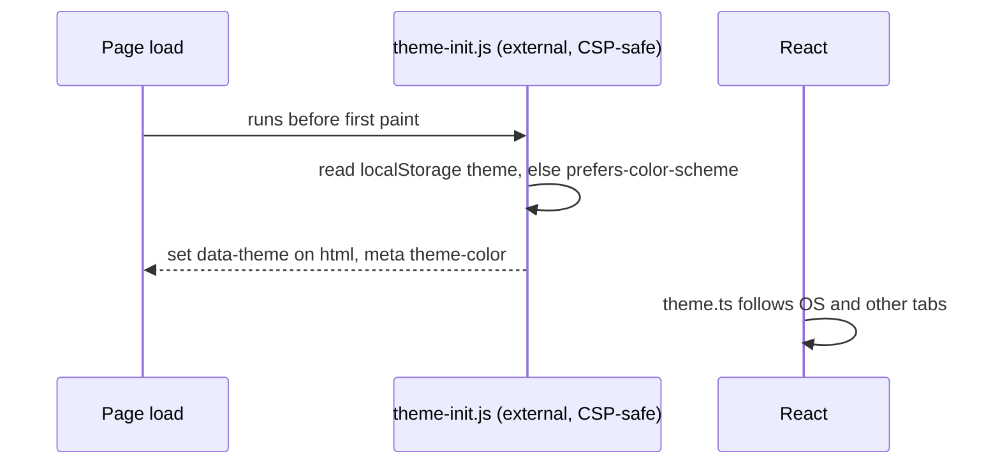
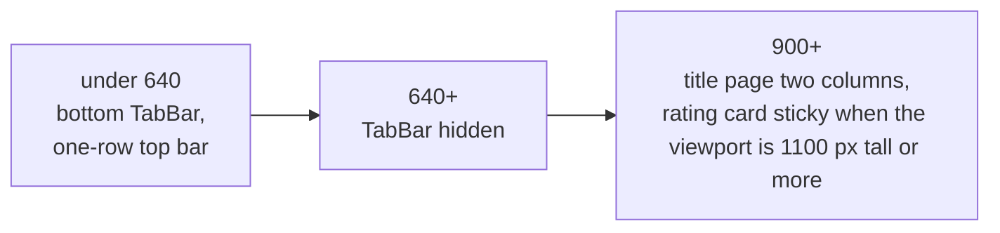

# Frontend

React 19, react-router 7, Vite, TypeScript. No Redux or query library: a few small stores and one fetch wrapper.

## Routes

There is no router guard. Each gated page checks the user itself. `/lists` redirects to `/my-list`.

## Shell

| Column | Pages |
|---|---|
| narrow | login, register, forgot-password, verify, support, email change, auth callback |
| reading | profile, review, lists, feed, stats, legal, settings |
| wide | the rest |

## Shared components

## State

## API calls

Messages come from the response's `message` or `errors[]`, else "Server error, try again" for 5xx or "Request failed (N)". A failed refresh drops that account from the stored list.

## Theme

Light, Dark or System, set from Settings, the avatar menu, or the footer when signed out. Pairs of colours are checked by `npm run check:contrast` in CI: 53 per theme, 4.5:1 for text, 3:1 for edges and the focus ring.

## Tokens

All colours are CSS variables. Dark is in `:root`, light in `:root[data-theme='light']`.

| Role | Token | Dark | Light |
|---|---|---|---|
| Page | `--bg` | `#141311` | `#f6f2ea` |
| Card | `--card` | `#1b1a17` | `#fffdf8` |
| Input, button | `--raised` | `#262420` | `#ebe5d8` |
| Text | `--text` | `#ece8e1` | `#1f1b16` |
| Accent | `--accent` | `#ff7a59` | `#a82d14` |
| Focus ring | `--focus` | `#6eb3ff` | `#0b5cad` |
| Negative | `--negative` | `#f2736d` | `#b3261e` |
| Positive | `--positive` | `#4cc38a` | `#1d7447` |
| Warning | `--warning` | `#e0a458` | `#965500` |

The accent marks the main action, the selected filter, the leading chart bar, the unread count and the score tag. Nothing else.

| | |
|---|---|
| Fonts | Geist for the interface, Space Grotesk for numbers (`.num`), self-hosted |
| Spacing | 4, 8, 12, 16, 20, 24, 32, 40, 48 |
| Radius | 4, 8, 12, 16 |
| Controls | 36 px tall, 44 px on phones |
| Motion | one curve, 150 / 200 / 320 ms, off under reduced motion |

## Breakpoints

Smaller tweaks at 399 and 359. There are also blocks for reduced motion, forced colors and no-hover devices. Full rules are in [STYLE.md](../STYLE.md).
