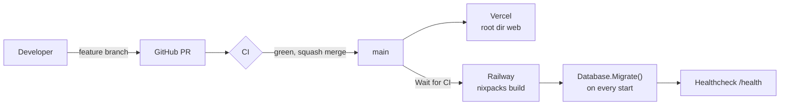
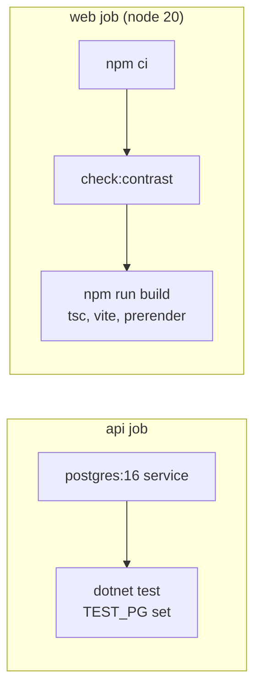
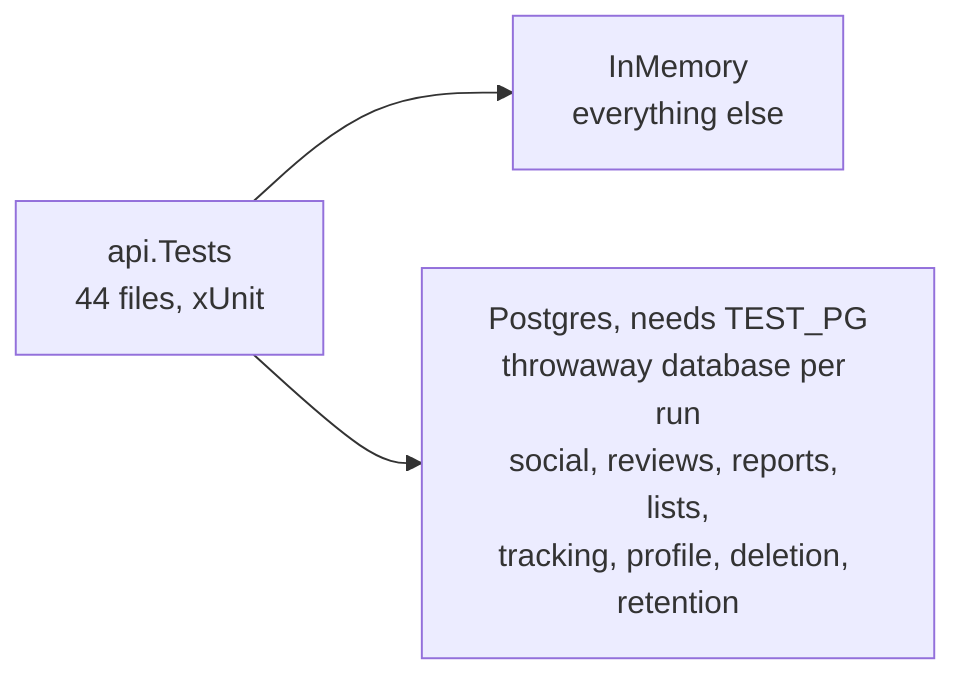
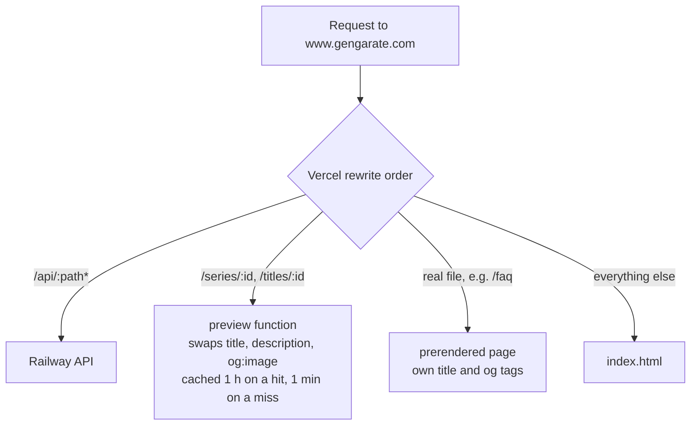
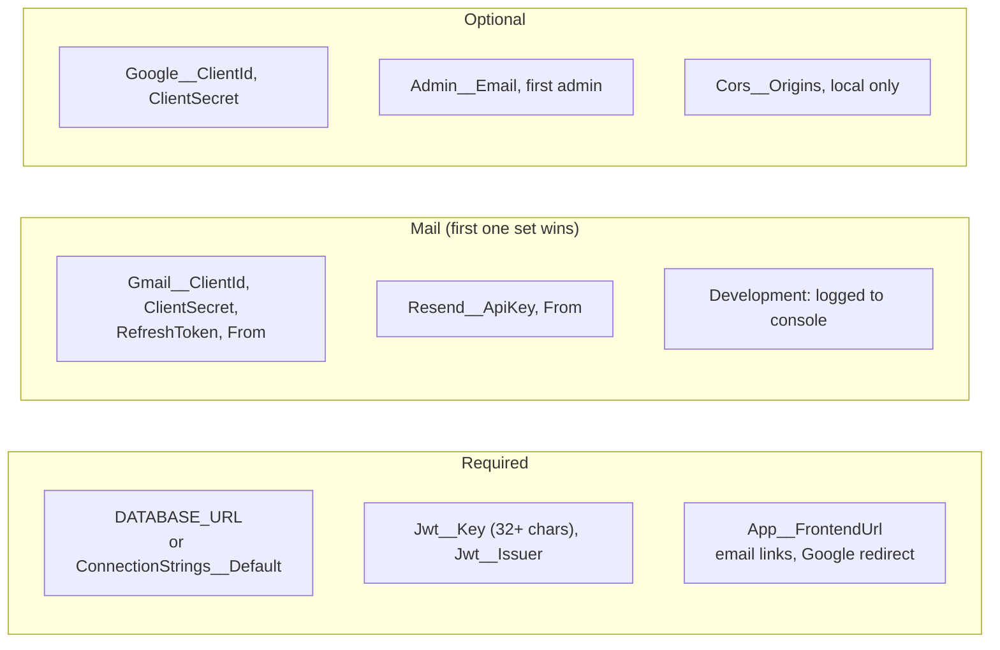
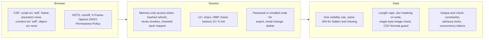

# Operations

## Deploy

## CI

Runs on pull requests and pushes to `main`. `npm run lint` (oxlint) exists but is not in CI.

## Tests

Covered: auth, sessions, lockout, Google, email, reviews, social, reports, lists, watch list, deletion, retention, export, import, censor, security headers, series, rankings, stats. The Postgres suites do nothing without `TEST_PG` because InMemory cannot check partial indexes, check constraints or advisory locks.

## Request edge

Crawlers do not run JavaScript, so they read the tags the function and the prerender step write. Unknown ids and API failures get the plain page.

## Configuration

Environment variables on Railway (`__` is nesting), or `dotnet user-secrets` in `api/` locally. No values are committed.

`Jwt__Issuer` should not change after launch: it signs everyone out. With no mail sender set, outside Development a send throws. First-time setup is in [DEPLOY.md](../DEPLOY.md).

## Rate limits

In memory, reset on restart. Per IP when signed out, per user otherwise.

| Where | Limit |
|---|---|
| Auth routes (not refresh or logout) | 10 / min per IP |
| Profile reads, stats, overview | 60 / min |
| Reactions, audience, lists, notifications | 120 / min |
| Avatar reads | 300 / min per IP |
| Friend requests | 20 / hour |
| Replies, bio, avatar writes, blocks | 30 / hour |
| Reports | 10 / hour |
| Export, account delete, support | 5 / hour |
| AniList list import | 1 / 10 min |
| Email code tries | 5 / 15 min, per address for reset, per account for verify and delete |
| Email send | 30 s (verify), 60 s (reset, email change, delete code) |

## Security layers

Known limits: `style-src 'unsafe-inline'`, rate limits reset on restart, the slur list has documented gaps, and profile pictures are public to everyone.
